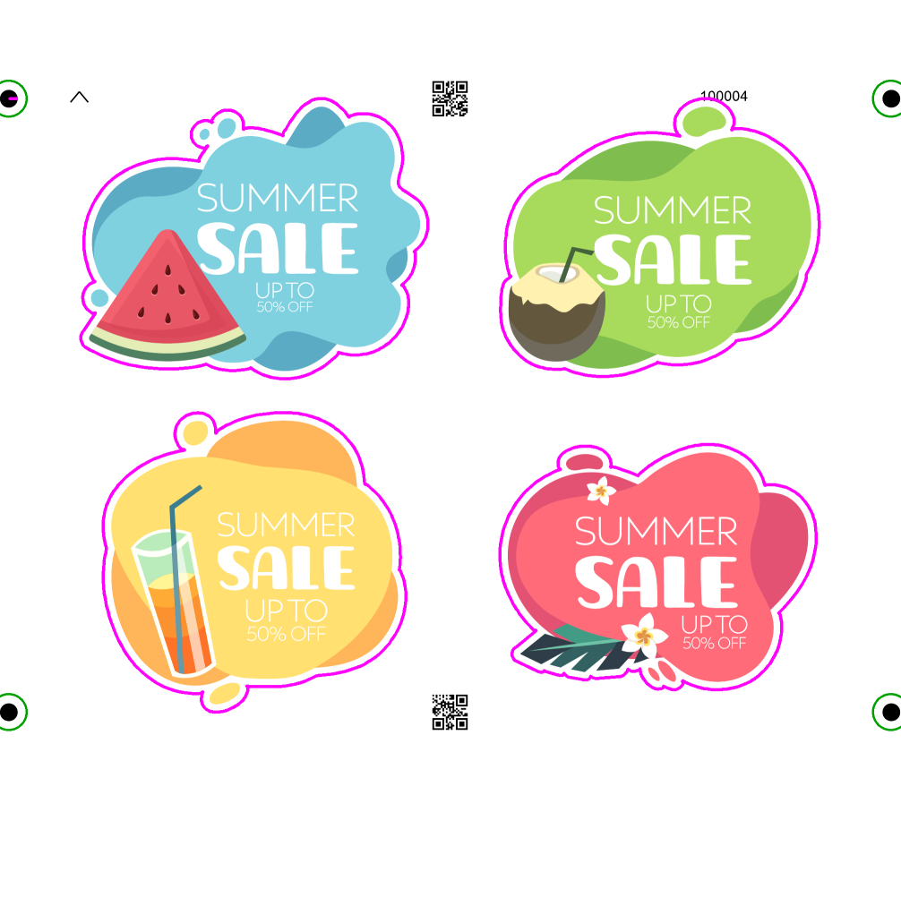

<picture>
  <source media="(prefers-color-scheme: dark)" srcset="docs/brand/recorte-banner-dark.svg">
  
</picture>

# Recorte

**A native macOS app for vinyl cutters, made for designers. For now it supports the Liyu GF-1261.**

Recorte opens on an empty canvas where you draw shapes, write text (outlined automatically)
and import Illustrator / SVG / PDF / DXF artwork. Press **⌘P**, choose how to cut, and
Recorte walks you through loading the machine. It also does **Print & Cut** with the
cutter's registration-mark camera, without SignMaster or a Windows VM.

Built by [CookieBytes](https://cookiebytes.pt) — software development & home automations.

- Swift 6, SwiftUI, macOS 14+
- English, Portuguese, French and Spanish (follows the system language)
- No drivers and no printer setup: Recorte finds the cutter on USB and sends the job straight
  to it (a serial-port transport is also included for other HPGL cutters)
- Projects are saved as `.recorte` files (older `.cookiecut` projects still open)

> **Status:** early development. The jobs Recorte sends match SignMaster's byte for byte,
> but not every feature has been tried on the machine yet. Other Liyu GF-series models may
> work but haven't been tried.

**This README is also the app's help page** (Help ▸ Recorte Help). Inside the app, hover over
any setting to see what it does, click **ⓘ** for a short explanation with a drawing, and open
**Help ▸ Getting Started** or **Help ▸ Keyboard Shortcuts** at any time.

## Contents

- [Getting started](#getting-started)
- [Drawing and importing](#drawing-and-importing)
- [Cutting vinyl (Cut only)](#cutting-vinyl-cut-only)
- [Print & Cut](#print--cut)
- [Speed, pressure and blade](#speed-pressure-and-blade)
- [Troubleshooting](#troubleshooting)
- [Coming from SignMaster](#coming-from-signmaster)
- [Keyboard shortcuts](#keyboard-shortcuts)
- [For developers](#for-developers)

## Getting started

### Install

Download `Recorte-<version>.zip` from the [latest release](https://github.com/cookiebytespt/Recorte/releases/latest),
unzip it and move **Recorte.app** to Applications. The app isn't notarised yet, so the first
time **right-click it ▸ Open** (or run `xattr -dr com.apple.quarantine /Applications/Recorte.app`).

The **Getting Started** window opens on the first launch with the four steps below.

### Connect the machine

The GF-1261 connects over USB ("LIYU CUTTING PLOTTER"). No driver and no printer setup are
needed.

1. Plug the cutter in with the USB cable and switch it on.
2. Press **⌘P**. Recorte finds the machine by itself and the status in the Output sheet turns
   green: **Ready**. **Settings ▸ Cutter** shows the machine it found.

Recorte only sends to the Liyu's own USB ID, so a job never goes to a printer by mistake.

### Make a test cut

With a new material or blade, press **Test cut** in the Output sheet: it cuts a small square
with a circle inside. The knife should cut through the vinyl and only scratch the backing.
If it doesn't, see [Speed, pressure and blade](#speed-pressure-and-blade).

## Drawing and importing

Recorte opens on an empty canvas (300 × 200 mm by default; change it, or pick a paper size,
in the sidebar). Pick a tool in the toolbar and drag on the canvas.

| Tool | Key | How |
|---|---|---|
| Select | V | click to select, drag to move, ⇧-click to add, handles to resize; double-click lines to edit their points |
| Pan | H | drag to move around; pinch or the zoom buttons to zoom |
| Rectangle, Ellipse | R, E | drag to draw, click for a 40 mm shape, ⇧ keeps it square / round |
| Line, Polygon, Star | L, G, S | drag to draw; sides, points and corner radius in the sidebar |
| Freehand | P | drag to draw; turn on *Closed shape* in the sidebar to cut out a piece |
| Text | T | click to place; text, font and size in the sidebar. Converted to outlines when cutting |

The sidebar shows the canvas settings, or the selected object's position, size, rotation and
options. In the **Layers** list you can hide objects (hidden objects are neither printed nor
cut) and lock them (locked objects can't be moved or deleted, but are still cut).

### Opening files

**File ▸ Import Artwork… (⇧⌘I)** adds a file as cut lines. You can also open these files
directly as a new project.

| Format | Notes |
|---|---|
| `.ai` | Must be saved with *Create PDF Compatible File* (Illustrator's default). First artboard only. |
| `.pdf` | First page. |
| `.svg` | Sizes without units are read at 72 per inch (Illustrator); switch to 96 in **Settings ▸ Files** if a file comes in at the wrong size. |
| `.dxf` | LINE, (LW)POLYLINE with bulges, CIRCLE, ARC, ELLIPSE, SPLINE. |

Text in imported files must be converted to outlines first (in Illustrator: *Type ▸ Create
Outlines*); Recorte warns when it skips text. Clipping paths and images are ignored when
importing cut lines. To print an image, use **Place artwork…** ([Print & Cut](#print--cut)).

### Editing lines

Select imported artwork or a cut contour to get the **Lines** section in the sidebar:

- **Edit Points** (or double-click the object, or press ↩): drag points, handles or whole
  lines; ⌥-click a line to add a point; ⌥-drag a point to pull out curve handles;
  double-click a point to switch between smooth and corner; ⌫ deletes. ↩ or Esc ends editing.
- **Keep Outer Lines Only** removes the lines inside other lines (for example the holes of a contour).
- **Split into Separate Objects** makes each line its own object.
- **Smooth into curves** replaces many small segments with fewer smooth curves.
- **Offset** grows (positive) or shrinks (negative) closed lines by a distance, with round corners.

## Cutting vinyl (Cut only)

1. Press **Cut…** in the toolbar or **⌘P**. The **Output** sheet opens with **Cut only** selected.
2. On the left, the preview shows the vinyl seen from above, you at the front, with the
   cutting width of the machine and the start point at the **front right** (the blade side,
   next to the machine's screen). Seen from the front, the design comes out upside down; it is
   not mirrored.
3. Check the settings on the right:
   - **Size and position:** size, scale, *Rotate 90°*, *Mirror* (for heat-transfer vinyl,
     which is cut from the back), **From the right** and **From the start** (distance from the
     start point to the design), and **Advance the vinyl after cutting** (feeds the vinyl past
     the design so it's easy to cut off; off returns the blade to the start).
   - **Cutting:** material, and [speed, pressure and blade](#speed-pressure-and-blade).
   - **Cut:** number of copies (cut one after another along the vinyl) and *Whole canvas* or
     *Selection only*.
4. Press **Cut…**. Recorte shows how to load the vinyl:
   1. Load the vinyl so its front edge is just past the blade, then lower the pinch rollers.
   2. Move the blade to the front-right corner of the vinyl, where the cut starts.
   3. Press **Origin** on the machine.
   4. Press **Cut**.
5. When it's done, choose **Cut again** for another copy or **Done**.

**Save HPGL…** saves the job as a file, for other cutting software or support; you don't need
it to cut.

## Print & Cut

Print your artwork with four registration marks on any printer; the machine's camera finds the
marks and cuts around the print.

### 1. Set up the sheet

1. Turn on **Print & Cut** in the canvas sidebar. The canvas becomes the printed sheet: set it
   to your paper size (**Page size** menu).
2. **Place artwork… (⌥⌘I)** adds a PDF, Illustrator, PNG or JPEG file to print. Placed artwork
   is printed, never cut.
3. Make the cut lines:
   - **Create Cut Contour… (⇧⌘K)** traces them for you (below), or
   - draw or import them on top of the artwork.

Keep everything inside the dashed safe area. By default the marks go **around the artwork**,
20.5 mm to its left and right, like SignMaster; you can put them **at the page edges** instead.
Marks turn red on the canvas when they fall off the page.

### 2. Create Cut Contour

Select the placed images (or none, for all of them) and choose **Object ▸ Create Cut Contour…**.

- **Shape:** *Follow the artwork* traces the outline; *Rectangle* or *Rounded* put a box around each image.
- **Distance from the artwork:** 2 mm by default. A small gap hides small differences between
  the print and the cut.
- **Corners** round or sharp, **Cut out holes** (transparent areas inside the image), **Smooth curves**.
- **Edge of the image:** *Transparency* (PNG, PDF, AI), *White background* (JPEG) or
  *Pick colour* (click the background in the preview, like Instant Alpha in Preview).
- **Ignore specks smaller than** 1 mm.

**Create Contour** adds one editable "Cut contour" object per image. With *Replace existing cut
contours* on, older contours for the same images are removed so they aren't cut twice.

### 3. Print

Press **Print & Cut…** or **⌘P**. In the Output sheet:

- **Registration marks:** *Mark size* must match the machine's setting (25 = Ø 5 mm circles),
  *Place the marks*, the distance or page insets, and the job name above the marks.
- **Printing:** *Print…* (at **100 % with no margins**, or the marks won't line up),
  *Save as PDF…*, *Save as image…* (PNG or TIFF, 150 / 300 / 600 dpi) or *Skip printing* if the
  sheet is already printed.
- The preview shows the sheet with the marks, the safe area and the origin mark (ringed);
  switch between *Both*, *Print* and *Cut*.

### 4. Load the sheet and cut

After printing, Recorte shows how to load the sheet:

1. Put the sheet in printed side up, **turned round so the arrow mark is at the front, on the
   right**.
2. Lower the pinch rollers and press **Pause** on the machine.
3. With the arrows on the panel, move the blade over **the arrow mark**, then press **Origin**.
4. Press **Next**. The machine visits the four marks, then cuts on its own.

Then tell Recorte how it went: **Cut finished**, or **Marks not found** to see a checklist and
**Try again** with the same sheet (no reprint needed). With several copies, Recorte asks for
each printed sheet in turn.

## Speed, pressure and blade

Open **Speed, pressure and blade** in the Output sheet.

- **Material** sets a starting speed and pressure. They are starting points: check with a test cut.

  | Material | Speed | Pressure |
  |---|---|---|
  | Standard vinyl | 300 mm/s | 80 g |
  | Thick vinyl | 200 mm/s | 120 g |
  | Heat-transfer vinyl | 250 mm/s | 90 g |
  | Flock | 150 mm/s | 150 g |
  | Cardstock | 150 mm/s | 140 g |
  | Reflective | 150 mm/s | 160 g |

- **Send speed and pressure to the machine** is **off** by default: the machine then uses the
  speed and pressure set on its own panel. Turn it on to send the values from Recorte with each
  job (SignMaster's *Cutting Speed / Cutting Force* ticked). The default can be changed in
  **Settings ▸ Cutter**.
- **Blade offset** (0.25 mm by default): the tip of a drag knife trails behind the centre of
  the holder, so Recorte adds a small loop at each corner to keep corners sharp. Rounded
  corners mean the offset is too small; extra marks at the corners mean it's too big.
- **Overcut** (1 mm): the knife carries on past the start of a closed shape so the ends meet.
- **Cut inner shapes first** keeps small pieces from moving; **Shortest knife path** reorders
  the shapes to save time.

Too little pressure leaves the vinyl uncut; too much cuts the backing. Change one thing at a
time and make a test cut after each change.

## Troubleshooting

| Problem | What to do |
|---|---|
| **The machine is not connected** | Check the USB cable and that the machine is on, then **Check again**. |
| **The machine is connected but doesn't respond** | Switch it off and on. If it still doesn't respond, turn on **Settings ▸ Cutter ▸ Troubleshooting**, open **Help ▸ Cutter Troubleshooting…**, press **Full check (safe)** and send the log (**Show log file**) to support. |
| **The machine didn't find the marks** | Nothing was cut. Check that the sheet is straight, printed side up, with the arrow mark at the front right; that the blade was on the arrow mark when you pressed Origin; that the marks are solid black and not under a pinch roller or tape; and that the sheet was printed at 100 % with the same mark size as the machine. Then **Try again** with the same sheet. Reprint only if the marks are damaged. |
| **The marks don't fit on the page** | Move the artwork away from the edges, use a bigger page or a smaller distance from the artwork. |
| **Cut lines must stay inside the marks** | Move the shapes that cross the marks, or place the marks around the artwork. |
| **Too wide for the machine** | Make the design smaller, rotate it 90°, or reduce *From the right*. |
| **The vinyl isn't cut through / the backing is cut** | Adjust the pressure (on the machine, or with *Send speed and pressure* on) and make a test cut. |
| **Corners are rounded or have extra nicks** | Adjust the blade offset and make a test cut. |
| **An SVG comes in at the wrong size** | **Settings ▸ Files ▸ Size of SVG files without units**: try the other option. |
| **Text was skipped when importing** | Convert it to outlines in your design app first (Illustrator: *Type ▸ Create Outlines*), or write the text in Recorte. |

To report a problem, use **Help ▸ Report a Problem…** or [open an issue](https://github.com/cookiebytespt/Recorte/issues/new).

## Coming from SignMaster

Recorte follows the same steps as SignMaster with this cutter, with plainer names. Help tags
in the app also give the SignMaster name.

| SignMaster | Recorte |
|---|---|
| Create Cut Contour (Build Contours / Build Boxes) | Create Cut Contour (*Follow the artwork* / *Rectangle*, *Rounded*) |
| Outline offset · Keep Holes | Distance from the artwork · Cut out holes |
| Contour Cut Wizard (Contour cut / ARMS) | Output sheet in **Print & Cut** mode, then the cut wizard |
| Mark Position (20.5 mm) | Distance from the artwork (marks *Around the artwork*) |
| Print Direct / Save PDF / Save as Image / Skip | Print… / Save as PDF… / Save as image… / Skip printing |
| View both / Print only / Cut only | Preview: Both / Print / Cut |
| Job Name | Job name on the sheet |
| Send to be Cut | Output sheet in **Cut only** mode |
| Advance After Plot | Advance the vinyl after cutting |
| Cutting Speed / Cutting Force (ticked) | Send speed and pressure to the machine |
| Cut Insides First | Cut inner shapes first |

## Keyboard shortcuts

| Keys | Action |
|---|---|
| V H R E L G S P T | Tools: Select, Pan, Rectangle, Ellipse, Line, Polygon, Star, Freehand, Text |
| ⇧ while drawing | Keep proportions |
| Esc | Back to the Select tool / stop editing points |
| ⌘D · ⌫ | Duplicate · Delete |
| ← → ↑ ↓ | Move the selection 1 mm |
| ⌘] · ⌘[ | Bring to Front · Send to Back |
| ⇧⌘A | Select All Objects |
| ⌘Z · ⇧⌘Z | Undo · Redo |
| ↩ | Edit points of the selected lines (↩ again to finish) |
| ⇧⌘I · ⌥⌘I | Import Artwork… · Place Artwork… |
| ⇧⌘K | Create Cut Contour… |
| ⌘P | Cut… / Print & Cut… |
| ⌘? | Recorte Help (this page) |

## For developers

### Build

Requirements: Xcode 16+, [XcodeGen](https://github.com/yonaskolb/XcodeGen) (`build.command`
installs it with Homebrew if missing).

```sh
./build.command        # xcodegen + core tests + swift build + xcodebuild → Recorte.app (log in build.log)
open Recorte.xcodeproj
```

Core tests (no Xcode project needed): `cd CutterCore && swift test`.
`swift build` at the root type-checks the whole app without Xcode. Run `xcodegen generate`
after adding or removing source files.

Publishing a GitHub release runs `.github/workflows/release.yml`: it tests, builds a universal,
ad-hoc signed app and attaches `Recorte-<version>.zip` (plus its SHA-256) to the release.

New controls need a help tag (`.help(…)`): what it does, when to change it, the SignMaster name
last. Strings shared by several views live in `App/Recorte/Help/HelpText.swift`; run
`python3 docs/tools/missing-help.py` to list controls without one. Every string needs en, pt,
fr and es in `Localizable.xcstrings`.

### How the protocol was worked out

Liyu publishes no protocol documentation, and its software is Windows-only. The USB traffic
from SignMaster was captured and decoded to learn the device identity (STM32, VID `0483` /
PID `5750`, USB printer class), the coordinate system and the Print & Cut preamble. SignMaster's
*Save as PLT* files then confirmed how speed, pressure and the advance are sent; Recorte's tests
rebuild those files byte for byte. The captures, the extraction script and a step-by-step
write-up are in **[docs/debugging](docs/debugging/README.md)**.



Print & Cut job (`CutterCore/Output/PrintAndCut.swift`):

```
TB<mark size>,<across steps>,<feed steps>;CT1;[SP1;VS<mm/s>;HS<g>;]<1024 spaces>\r\n
IN;SP1;PU…;PD…;…
PU<feed steps>,0;PG!;\r\n
```

Plain cut job, one line (`CutterCore/Output/HPGL.swift`):

```
IN;SP1;[SP1;VS<mm/s>;HS<g>;]PU…;PD…;…;PU<job length>,0;PG;\r\n
```

40 steps per mm; plotter X runs along the feed, Y across the media. Print & Cut coordinates are
relative to the top-left (arrow) mark, which is the front-right corner once the sheet is loaded.
Speed and pressure are sent only when *Send speed and pressure* is on.

### Project layout

```
project.yml              XcodeGen spec for the app (generates Recorte.xcodeproj)
App/Recorte/             SwiftUI app (document-based: File ▸ Open, recents, drag to Dock)
  Model/                 Editor state, Output session, cutter connection, preferences
  Views/                 Canvas, sidebar, Output sheet, cut wizard, Create Cut Contour, settings
  Help/                  Help tags, ⓘ popovers, Getting Started, shortcuts, Help menu, tips
CutterCore/              Swift package with all the logic, testable without the app
  Design/                Project model: canvas, shapes, text (CoreText outlines), path editing
  Geometry/              Point/Rect/AffineTransform, Bézier paths, Polyline, curve flattening
  Import/                SVG, PDF/AI (CoreGraphics), DXF importers
  Processing/            Cut ordering, blade-offset compensation, job planner, contour tracing
  Output/                HPGL and Print & Cut generators, print sheet renderer
  Transport/             USB (IOUSBHost, straight to the cutter) and serial port (termios) transports
  Diagnostics/           Connection checks behind Help ▸ Cutter Troubleshooting
  Machine/               Machine profile (GF-1261) and material presets
docs/brand/              Icon and banner sources
docs/debugging/          USB captures, SignMaster PLT files, extraction script and protocol write-up
docs/reference/          SignMaster screenshots used as a reference for the output flow
docs/tools/              Developer helper scripts
```

## Roadmap

- Blades and cutting presets (named blades, saved presets, passes), like SignMaster's Vinyl Spooler.
- Multiple artboards / pages picker.
- Weeding lines and tiling for jobs longer than the media.
- Notarised Developer ID build for distribution.

## Contributing

Issues and pull requests are welcome. USB captures from other Liyu models, or from jobs that
use different settings, help most: the [debugging write-up](docs/debugging/README.md) shows
how to make one and what is still unknown.

## Logo

The icon is a vinyl sticker with its corner lifting, and the R is cut (weeded) out of it so the
coral tile shows through. The source is [`docs/brand/recorte-icon.svg`](docs/brand/recorte-icon.svg)
(1024 × 1024 on the macOS icon grid). The app icon PNGs in
`App/Recorte/Resources/Assets.xcassets/AppIcon.appiconset` are rendered from it.

The README banner (`docs/brand/recorte-banner-light.svg` and `-dark.svg`) pairs the icon with
the wordmark in Bricolage Grotesque SemiBold and the slogan "cutting studio for macOS". The
text is converted to outlines so it renders without the font; `docs/brand/make-banner.py`
regenerates both files.

| Colour | Hex |
| --- | --- |
| Coral (tile) | `#E8553D` |
| Vinyl | `#FFFFFF` |
| Backing (peeled corner) | `#EADFD6` |

---

Made by [CookieBytes](https://cookiebytes.pt) · [Instagram](https://www.instagram.com/cookiebytes.pt)
